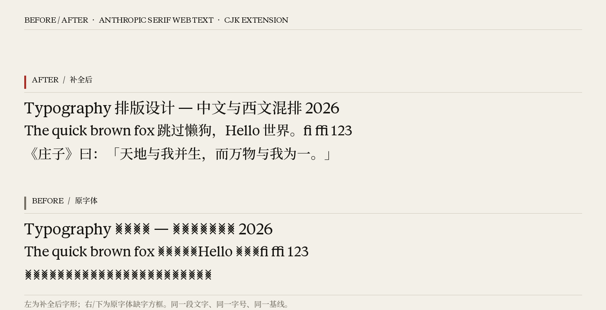
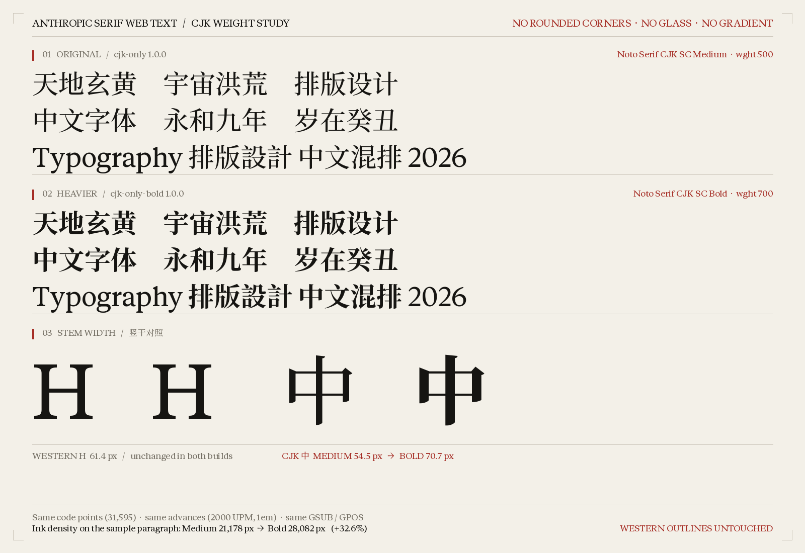
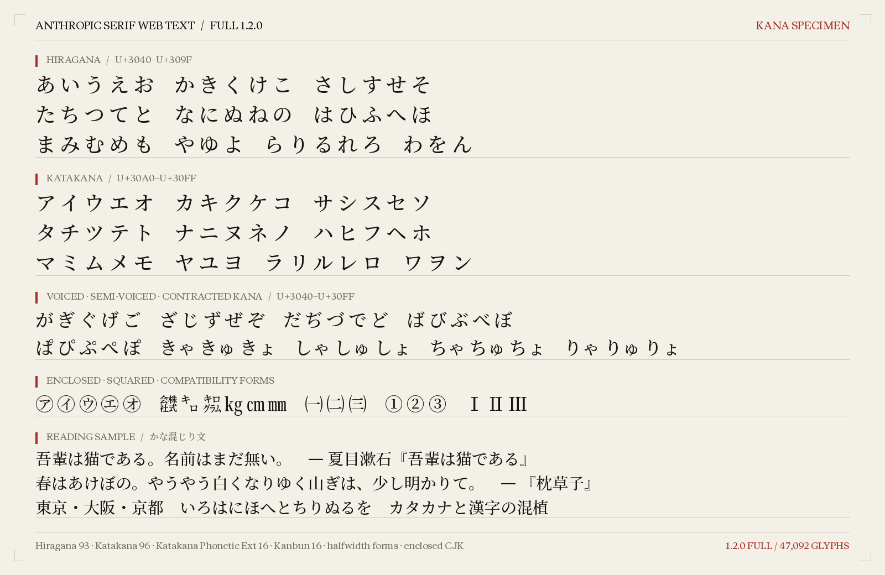
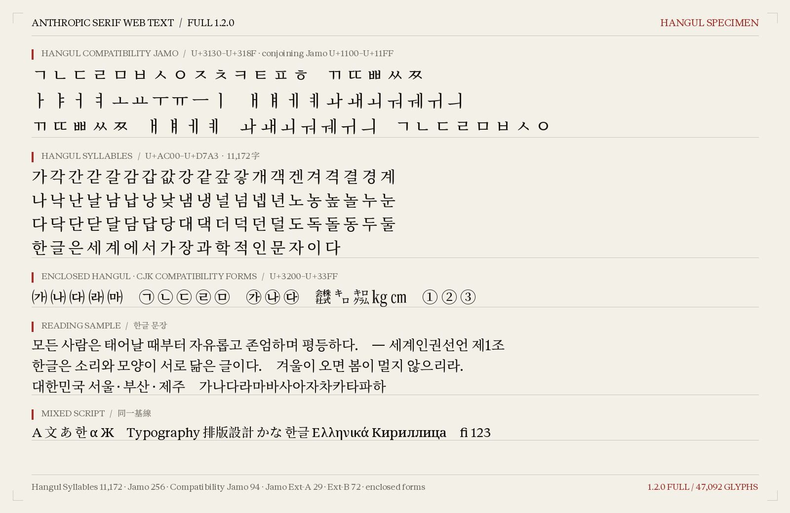
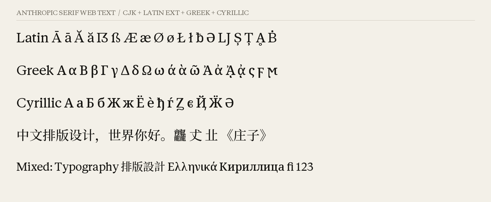
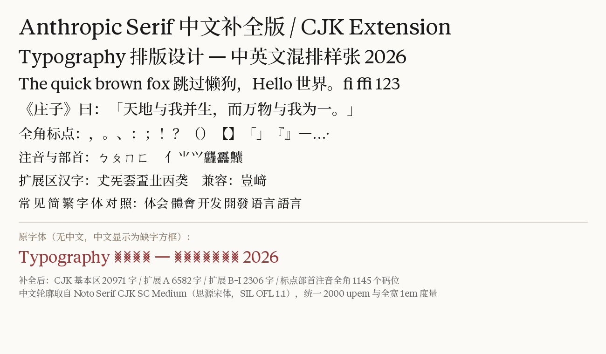

# Anthropic Serif CJK Rebuild

[](docs/COMPLIANCE.md) [](docs/BUILD.md) [](docs/CHARACTER-SET.md) [](docs/BUILD.md) [](OFL.txt) [](docs/COMPLIANCE.md)

从源码**重新制作**一套多文种衬线字体的完整工程。仓库里**没有任何字体文件**：你自备一份合法取得的上游西文字体，再准备两个开源字族，运行脚本即可在本机生成成品。

与直接分发字体二进制的仓库不同，这里交付的是**方法、参数与可复现流程**。构建出的字体默认使用全新的内部家族名 `Serif CJK Extension`，不含上游品牌字样，是一版独立命名的字体，而不是对既有文件的复制或改名分发。

---

## 先读这一节：为什么没有字体文件

上游西文字体是 Anthropic, PBC 的专有品牌字体，官方未提供公开的字体授权。把它的完整轮廓打包进一个公开仓库再分发，权利状态并不清晰。因此本仓库采用保守发布路径：

- 只提交构建脚本、文档、许可文本与样张图片；
- `*.ttf`、`*.otf`、`*.woff2`、`*.ttc` 等字体二进制全部写进 [`.gitignore`](.gitignore)，不进版本库，也不作为 Release 附件；
- 上游字体由你本人提供，放在本地 `inputs/` 目录，脚本只读取、不上传；
- 生成的成品落在本地 `build/` 目录，同样被忽略。

这样，全部方法、全部 OFL 衍生贡献与全部验证数据都是公开的，而专有轮廓不发生公开再分发。完整论证、OFL 义务清单与自查表见 [docs/COMPLIANCE.md](docs/COMPLIANCE.md)。

如果你只是想下载现成文件，同一维护者另有一个包含预构建字体的仓库：
[Anthropic-Serif-CJK-Extension](https://github.com/Moirania/Anthropic-Serif-CJK-Extension)。
那个仓库的公开分发风险由其自身说明承担，使用前同样请自行核实授权。

---

## 这套字体做了什么

原西文字体只有 628 个码位、720 个字形，中文、假名、韩文、希腊文、西里尔文全部缺失，中英混排时中文会退化为缺字方框。本工程在**不改动任何西文字形、不改动原有 OpenType 排版特性、不改动原有字形编号顺序**的前提下追加字形：

- 新增轮廓统一到 2000 UPM，中文与假名全宽 1em，韩文音节 1932 单位；
- 「A」「文」「あ」「한」「α」「Ж」落在同一条基线与同一套垂直度量上；
- 原字体的 19 个 GSUB 特性（连字 `fi`/`ffi`、小型大写、旧式数字、分数、样式集等）与 2 个 GPOS 特性全部保留，因为新字形只追加在字形表末尾，原 glyph id 未变；
- 四类预设对应四种覆盖级别，从「只补中文」到「中日韩加希腊西里尔全覆盖」。

**为什么叫「重新制作」**：默认输出会重写 `name` 表，家族名改为 `Serif CJK Extension`，PostScript 名改为 `SerifCJKExtension-Regular`，版本串按预设重设。它是一份按公开工程重新生成、独立命名的新字体，而不是把某个现成二进制另存一份。想完全复刻原命名，加 `--keep-upstream-name` 即可。

---

## 四档预设

| 预设 | 中文轮廓 | 追加码位 | 字形 | 可用码位 | 适用 |
| --- | --- | --- | --- | --- | --- |
| `cjk` | Noto Serif CJK SC Medium | 31,004 | 31,724 | 31,595 | 只要中文，体积最小 |
| `cjk-bold` | Noto Serif CJK SC Bold | 31,004 | 31,724 | 31,595 | 觉得中文偏细偏淡 |
| `multilingual` | Medium | 33,177 | 33,897 | 33,768 | 中英希俄、IPA、polytonic 希腊 |
| `full` | Medium | 46,372 | 47,092 | 46,963 | 再加假名、韩文与 CJK 符号 |

`cjk` 与 `cjk-bold` 的码位完全一致，只有中文轮廓字重不同。实测同一段文字墨色从 21,178 px 增至 28,082 px（+32.6%），中文「中」竖干从 54.5 px 增至 70.7 px，而西文 `H` 竖干 61.4 px 纹丝不动。七档字重的实测表见 [docs/BUILD.md](docs/BUILD.md)。


---

## 快速开始

### 1. 准备材料

| 材料 | 用途 | 获取 |
| --- | --- | --- |
| 上游西文 TTF | 基座，只有它能提供原始西文轮廓 | 你自行合法取得的副本，放到 `inputs/` |
| Noto Serif CJK TTC | 中文、假名、韩文、CJK 符号 | `apt install fonts-noto-cjk`，或 [notofonts/noto-cjk](https://github.com/notofonts/noto-cjk) |
| Noto Serif 可变字体 | 拉丁扩展、希腊、西里尔 | `fonts-noto` 系列，或 [notofonts/latin-greek-cyrillic](https://github.com/notofonts/latin-greek-cyrillic) |

后两者均为 [SIL Open Font License 1.1](OFL.txt)。上游西文字体是专有字体，**不随本仓库提供**。

### 2. 安装依赖

```bash
python3 -m pip install fonttools brotli
```

Debian / Ubuntu 上可直接 `apt install python3-fonttools fonts-noto-cjk fonts-noto`。

### 3. 一行构建

```bash
python3 scripts/build_cjk.py \
  --latin inputs/AnthropicSerifWebText.ttf \
  --source-dir /usr/share/fonts/opentype/noto \
  --preset cjk
```

把 `--preset` 换成 `cjk-bold`、`multilingual` 或 `full` 即可得到另外三版。成品默认写到 `build/SerifCJKExtension-CJK.ttf` 等路径。若 Noto 字体分散在不同目录，用 `--cjk-ttc` 与 `--lgc-font` 分别指定绝对路径。

### 4. 转换与校验

```bash
python3 scripts/make_woff2.py build/SerifCJKExtension-CJK.ttf
python3 scripts/verify.py build/SerifCJKExtension-CJK.ttf --preset cjk
```

`verify.py` 会打印家族名、版本号、UPM、垂直度量、字形数、码位数、cmap 子表、GSUB/GPOS 数量，并逐个检查拉丁、中文、希腊、假名、韩文与符号的样例码位。四档预设的期望数值已内置。

---

## 用法示例（构建产物）

网页使用，把 WOFF2 放进静态目录：

```css
@font-face {
  font-family: "Serif CJK Extension";
  src: url("/fonts/SerifCJKExtension-Full.woff2") format("woff2");
  font-weight: 400;
  font-style: normal;
  font-display: swap;
}

body {
  font-family: "Serif CJK Extension", Georgia, serif;
  font-feature-settings: "liga" 1, "kern" 1;
}
```

桌面安装：双击 TTF（Windows 选「安装」，macOS 用「字体册」，Linux 复制到 `~/.local/share/fonts/` 后执行 `fc-cache -fv`）。四档预设内部家族名相同，**同一台机器只装一版**；`cjk` 与 `cjk-bold` 的子族名也都是 Regular，尤其不能并存。

更多排版示例、子集化命令、渲染注意事项与故障排查见 [docs/USAGE.md](docs/USAGE.md)。

---

## 效果预览

样张图片由本地构建产物渲染，随仓库公开，方便在动手前判断风格。沿用印刷校样的视觉语言：米白纸底、墨黑字、朱红只作标记、1px 硬线网格、四角裁切标记、左对齐、大留白，没有圆角玻璃拟态、渐变大按钮和三栏功能介绍。

**补全前后**：同一段文字，原字体的中文显示为缺字方框。



**中文字重对照**：Medium 与 Bold 两档，末节并列西文 `H` 与中文「中」的竖干。



**假名预览**：五十音、浊音拗音、带圈方块符号与日文样句。



**韩文预览**：兼容 Jamo、音节抽样、带圈韩文、韩文句段与六文混排。



**多文种样张**与**双语排版样张**：





---

## 构建原理

脚本分九步：读取基座并记录字形顺序与垂直度量 → 按预设筛选来源码位 → CFF 三次曲线用 `cu2qu` 转二次并缩放 2000 UPM → Noto Serif 可变字体实例化到 `wght=500` → 展开复合字形并缩放 → 设定中文全宽与其余字形的推进宽度 → **只追加**新字形 → 更新四张 cmap 子表并生成 format 12 → 重算 `maxp`/`hhea`/`head`/`OS/2` 与 `name` 表。

「只追加」是关键：原有 720 个 glyph id 全部保持有效，所以不需要重写任何 GSUB/GPOS 查找表。`full` 模式会取 CJK 来源里所有尚未覆盖的码位，但排除集用的是 LGC 来源**实际**的 cmap，而不是名义 Unicode 范围——像 U+2160 罗马数字一这类 Noto Serif 没有、思源宋体却有的字符，才不会被误排除而留下缺口。

完整步骤、参数表、七档字重实测、验证清单、改名与已知取舍见 [docs/BUILD.md](docs/BUILD.md)。

---

## 文档导航

| 文档 | 内容 |
| --- | --- |
| [docs/COMPLIANCE.md](docs/COMPLIANCE.md) | 为什么不含二进制、上游授权、OFL 义务、商标与再分发自查 |
| [docs/BUILD.md](docs/BUILD.md) | 依赖、目录布局、四档构建命令、参数表、字重实测、验证与改名 |
| [docs/CHARACTER-SET.md](docs/CHARACTER-SET.md) | 按 Unicode 分区的逐段覆盖明细与刻意不收录的范围 |
| [docs/USAGE.md](docs/USAGE.md) | 安装、CSS、多语言示例、OpenType 特性、子集化、渲染注意事项 |
| [FONTLOG.txt](FONTLOG.txt) | 逐项修改记录与版本历史，遵循 OFL 惯例 |
| [CONTRIBUTING.md](CONTRIBUTING.md) | 贡献方式与二进制红线 |
| [CODE_OF_CONDUCT.md](CODE_OF_CONDUCT.md) | 社区行为准则 |
| [SOURCE-MANIFEST.txt](SOURCE-MANIFEST.txt) | 仓库内全部文件的 SHA-256，便于校验来源包完整性 |

## 项目结构

```
.
├── scripts/
│   ├── build_cjk.py      构建脚本，四档预设
│   ├── make_woff2.py     TTF 转 WOFF2
│   └── verify.py         产物结构与字符覆盖校验
├── docs/                 合规、构建、字符集、使用四篇文档
├── assets/               六张样张图（图片不含字体软件）
├── inputs/               本地放上游字体，被 .gitignore 排除
├── build/                本地产物，被 .gitignore 排除
├── README.md             本文件
├── LICENSE               文档与脚本许可，以及分层授权说明
├── OFL.txt               SIL Open Font License 1.1 全文
├── FONTLOG.txt           修改记录与版本历史
├── CITATION.cff          引用信息
├── SOURCE-MANIFEST.txt   文件校验清单
└── .gitignore            排除全部字体二进制与凭证
```

## 获取帮助

- 构建报错：先对照 [docs/BUILD.md](docs/BUILD.md) 的「材料目录布局」一节，确认三个输入路径都存在且可读。
- 缺字、字形错位、行高异常：到 [Issues](https://github.com/Moirania/Anthropic-Serif-CJK-Rebuild/issues) 附上**所用预设**、字符码位、操作系统与渲染引擎版本，以及截图。**不要**在 issue 里上传字体二进制或上游字体文件。
- 授权问题：先读 [docs/COMPLIANCE.md](docs/COMPLIANCE.md)；本仓库无法代替权利人给出授权结论。

## 贡献与维护

欢迎提交缺字报告、构建脚本改进、文档修正与样张优化，流程见 [CONTRIBUTING.md](CONTRIBUTING.md)。两条红线：任何 PR 都**不得**提交字体二进制、上游字体文件或凭证；涉及新增轮廓来源的改动必须写明来源与许可。仓库由 [Moirania](https://github.com/Moirania) 维护。

## 许可证

- 仓库中的文档、脚本与样张图：见 [LICENSE](LICENSE)。
- 你本地生成字体里的新增轮廓（中文、假名、韩文、拉丁扩展、希腊、西里尔）：[SIL Open Font License 1.1](OFL.txt)，版权与条件见 [LICENSE](LICENSE) 与 [FONTLOG.txt](FONTLOG.txt)。
- 上游西文轮廓：专有字体，权利归 Anthropic, PBC 所有，**不适用**上述任何开源许可，也不由本仓库提供或再授权。完整说明见 [docs/COMPLIANCE.md](docs/COMPLIANCE.md)。

## 致谢

- 基座：Anthropic Serif Web Text Regular（专有，需自备合法副本）。
- 中文、假名、韩文与 CJK 符号轮廓：Noto Serif CJK SC / 思源宋体，Adobe 与 Google 等贡献者，SIL OFL 1.1。
- 拉丁扩展、希腊、西里尔轮廓：Noto Serif（latin-greek-cyrillic），The Noto Project Authors，SIL OFL 1.1。
- 构建工具：fontTools（`cu2qu`、`varLib.instancer`、`ttLib`、`DecomposingRecordingPen`）。

本项目与 Anthropic、Adobe、Google 均无 affiliation。仓库名仅用于描述被重建的对象，不代表任何一方的赞助、背书或参与。
